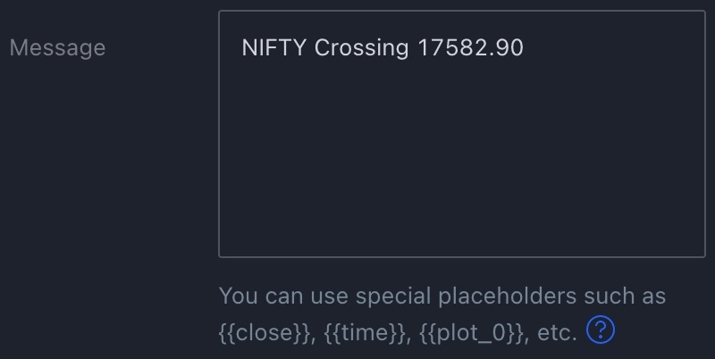
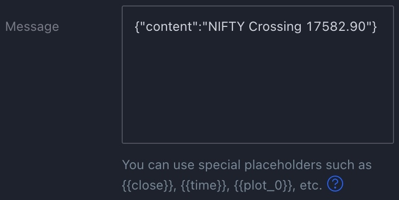

<div align="center">
<h1 align="center">TradingView Discord Webhook Middleware</h1>
<br />
<br>

<br>
A FastAPI middleware for forwarding TradingView webhook alerts to a Discord channel without manually converting every TradingView alert message into Discord's required JSON format.
</div>

***

## What it does

TradingView can send alert webhook bodies as plain text. Discord webhooks expect JSON like:

```json
{"content": "your alert message"}
```

This service receives the raw TradingView alert body at `POST /webhook`, wraps it as Discord `content`, forwards it to `DISCORD_WEBHOOK_URL`, and returns the original alert text.

Default    |  Required
:-------------------------:|:-------------------------:
  |  

## Endpoints

- `GET /` - simple online message.
- `GET /health` - health check endpoint for Docker/Coolify.
- `POST /webhook` - TradingView webhook receiver.

## Configuration

Copy the example environment file and set your Discord webhook URL:

```bash
cp .env.example .env
```

Required environment variables:

```bash
DISCORD_WEBHOOK_URL=https://discord.com/api/webhooks/your-webhook-id/your-webhook-token
```

Optional environment variables:

```bash
DISCORD_TIMEOUT_SECONDS=10
```

## Local development with uv

Install dependencies:

```bash
uv sync
```

Run the API:

```bash
uv run uvicorn src.main:app --host 0.0.0.0 --port 8000 --reload
```

Open:

```text
http://localhost:8000
```

Run tests:

```bash
uv run pytest
```

## Docker

Build the image:

```bash
docker build -t tradingview-discord-middleware .
```

Run it locally:

```bash
docker run --rm -p 8000:8000 \
  -e DISCORD_WEBHOOK_URL="https://discord.com/api/webhooks/your-webhook-id/your-webhook-token" \
  tradingview-discord-middleware
```

Test the middleware:

```bash
curl -X POST http://localhost:8000/webhook \
  -H "Content-Type: text/plain" \
  --data "BTCUSD crossed 70000"
```

## Deploy on Coolify

Use these steps for a Coolify instance running on your Hetzner server:

1. Push this repository to GitHub, GitLab, or another Git provider connected to Coolify.
2. In Coolify, create a new resource and choose your Git repository.
3. Select `Dockerfile` as the build pack/source type.
4. Set the public port to `8000`.
5. Add environment variables:

```bash
DISCORD_WEBHOOK_URL=https://discord.com/api/webhooks/your-webhook-id/your-webhook-token
DISCORD_TIMEOUT_SECONDS=10
```

6. Configure the health check path as `/health`.
7. Deploy the service.
8. After deployment, copy the public Coolify URL and use this TradingView webhook URL:

```text
https://your-coolify-domain.example.com/webhook
```

## TradingView setup

In the TradingView alert dialog:

1. Enable `Webhook URL`.
2. Paste the deployed `/webhook` URL from Coolify.
3. Put the alert text you want Discord to receive in the TradingView message box.
4. Save the alert.

Discord will receive the exact alert text as a webhook message.

## License

This project is licensed under the MIT license.
